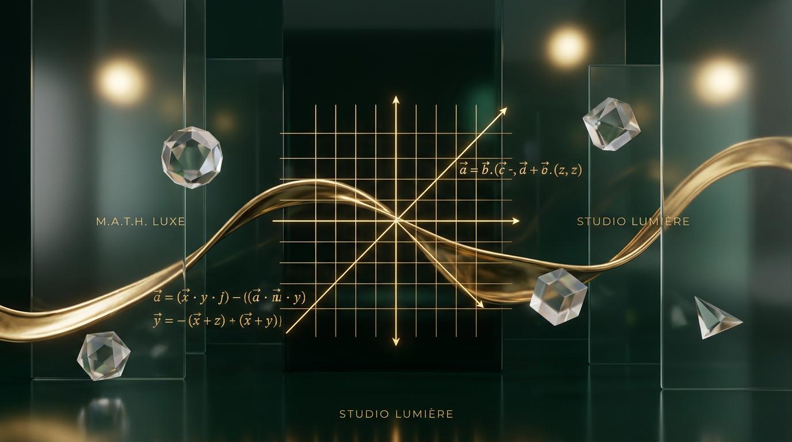

<!-- High-end Generated Banner -->

 

 

<!-- Large, elegant visual badge portals -->

&nbsp;&nbsp;

&nbsp;&nbsp;

 

  

 

> With a background in **Pure Mathematics & Computer Science**, I construct web-based environments where digital assets behave like physical elements. I treat UI motion, rendering performance, and database structures as cohesive mathematical systems to be sculpted—not just wired together.

---

## 🔮 THE DIGITAL EXHIBITIONS

### 🌌 Orbit — The 3D Gravity Universe
*An interactive Three.js solar system representing real-time GitHub repository data as orbiting planetary bodies.*

🪐 **[Launch the 3D Gravity Universe](https://orbit-tablawy.vercel.app/)**
* **The Motion:** Physically-modeled orbital paths governed by dynamic gravity calculations in WebGL.
* **The Optics:** Smooth, momentum-based camera focus shifts with custom ambient-lit atmospheres.

 

### 🏺 Scent Compounding 3D Laboratory
*An ultra-luxury interactive digital fragrance lab built with physical material rendering.*

🧪 **[Enter the Fragrance Studio](https://github.com/galilio2023/perfume-tablawy)**
* **The Motion:** Real-time fluid shader balancing formulas that prevent mathematical rounding drift.
* **The Optics:** Glassmorphic physical glass refractions and gold-lacquer clearcoat reflection passes.

 

### 📐 iKitchen — Spatial Generative CAD
*A web-based SaaS merging spatial vector boards with Google Gemini generative intelligence.*

🧱 **[Open the Spatial Workspace](https://github.com/galilio2023/ikitchen)**
* **The Motion:** Fluid 2D drag-and-drop mechanics mapped onto spatial coordinate matrices.
* **The Optics:** Minimalist architectural drafting board aesthetics built for seamless spatial visualization.

---

### 🎨 THE PALETTE (My Stack)

  

 

  
  

 

  

