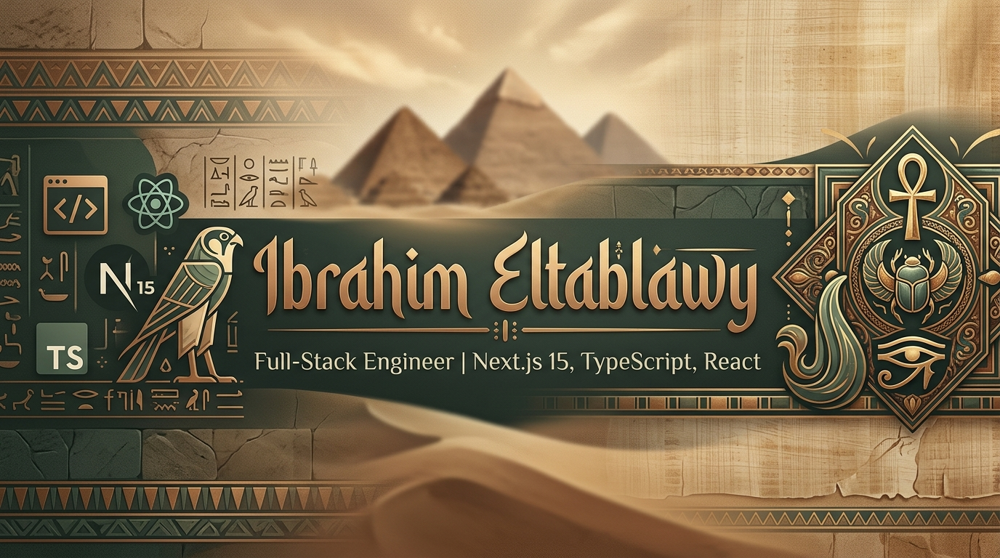

 

> [!TIP]
> `Ctrl`/`Cmd` + Click any button above to open it in a new tab.

 

B.Sc. in Pure Mathematics & Computer Science (2010), with 13 years in the medical sector before moving fully into software. That background shows up in how I build: state management and motion design treated as systems to model precisely, not just wire together.

 

### Portfolio & Resume Engine
*High-performance interface — Vite, React 19, Tailwind v4*

A resume site with a custom generation engine: state-driven content, Formspree-backed lead capture, built for both human visitors and ATS parsing.

 

### Orbit — 3D Repository Visualizer
*Three.js solar system where each planet is a live GitHub repository*

Real-time GitHub sync, physically-modeled orbital motion, and a full admin dashboard for managing the visualized data.

 

### Stack

  

  

 

**Currently building:** modular React 19 + Tailwind v4 interfaces with motion driven by real physics/math models (GSAP, Framer Motion, Three.js) rather than canned easing presets.

